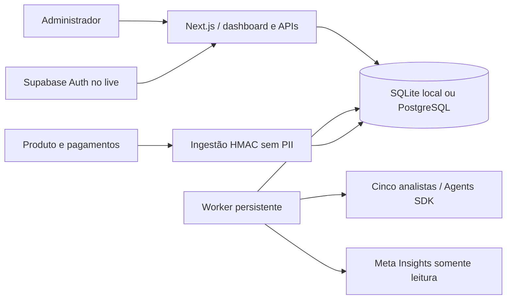

# Arquitetura e contratos

`lib/db.ts`: adaptador assíncrono SQLite/PostgreSQL. `DATABASE_URL` tem prioridade mesmo em simulação, permitindo staging distribuído com dados sintéticos. Live exige PostgreSQL. SQL utiliza placeholders numerados em ordem, uma ocorrência de cada, para compatibilidade SQLite. Migração idempotente em `lib/schema.ts`, espelhada no SQL e conferida por teste. `init` aplica DDL no início; para produção, separar papel migrador e papel runtime em incremento futuro. Não execute migrações destrutivas no boot.

`lib/store.ts`: políticas, audit e agendamento idempotente. `lib/worker.ts`: claim atômico, lease, retries e fencing antes de inserir decisão. Decisão, conclusão do job e evento de auditoria são gravados na mesma transação. Kill switch e políticas são verificados antes e depois da análise. Uma requisição de leitura/modelo já em voo pode terminar e incorrer em custo OpenAI ao pausar; o resultado é descartado se a pausa já tiver sido confirmada antes da transação de commit. A API não executa o worker: deploy dele é obrigatório. O processo volta ao trabalho pendente depois de reiniciar; não faz backfill de horas nas quais o scheduler não estava rodando.

`lib/agents.ts`: saída Zod, no máximo três turns, sem tools de escrita. Tracing do SDK desativado para não exportar contexto involuntariamente. Prompts tratam dados externos como não confiáveis. Modo simulado nunca exige OpenAI, Meta ou Supabase. Diretor recebe decisões recentes para coordenar prioridades; nenhuma recomendação vira ação automaticamente.

## Segurança

- Simulação: senha administrativa via env, comparação scrypt/timing-safe, sessão HMAC de 8h e nonce; cookies HttpOnly, SameSite Strict, Secure em produção. Rotação de SESSION_SECRET invalida sessões. É um workspace administrativo único; sem RBAC multi-tenant.
- Live: Supabase Auth, usuário deve ter `app_metadata.growth_role=admin`, definido apenas pelo administrador Supabase. Token é validado no servidor em cada requisição. Sem refresh nesta versão; entre novamente ao expirar. Não use user_metadata para autorização. Não há cadastro público na aplicação.
- Mutations exigem origem exata (`APP_ORIGIN` no live) e autenticação. Login usa throttle global persistente de 10 tentativas/15 minutos; é um guardrail simples, não substitui WAF e proteção anti-DoS do provedor. Não armazena IP.
- RLS habilitado em todas as tabelas PostgreSQL, sem policies públicas; acesso ao banco somente backend com papel apropriado. `DATABASE_URL` nunca é `NEXT_PUBLIC`. Credenciais de serviço nunca chegam ao browser. Tabelas não devem ser expostas a clientes via PostgREST.
- Orçamento de mídia inicia em zero, permissões efetivas limitadas a analyze/propose. Gastos e publicação são recusados independentemente de env, flags ou orçamento.
- Erros de jobs são classificados sem payloads upstream/secrets. Audit registra eventos e decisões; não é armazenamento imutável/WORM. Um administrador do banco pode alterar registros; proteção contra adulteração externa é trabalho futuro.
- Dados pessoais não são aceitos pelo schema de ingestão. Faça redaction antes de usar campos de texto livre de rascunhos; a UI não aplica DLP. Política de retenção/exportação, exclusão, backup e alertas devem ser definidos antes da produção.

## Ingestão

POST `/api/ingest`, corpo JSON estrito: `id` UUID do evento, `occurredAt` ISO UTC, `kind` (`lead`, `qualified_lead`, `purchase`, `refund`), `amountCents` inteiro >=0, `currency=BRL`, `channel` (`meta`, `instagram`, `organic`, `direct`, `other`). Sem identificador de pessoa. Reembolsos usam valor positivo e tipo refund. Não há reconciliação financeira ainda.

Headers: `x-growth-timestamp` UNIX em segundos; `x-growth-signature` hex HMAC-SHA256 de `timestamp + "." + corpo_exato` com `INGEST_SIGNING_SECRET`. Janela de cinco minutos, limite de 8 KiB e unicidade pelo `id`. Reenvio retorna 202 com `duplicate=true`. A chave idempotente é do evento do provedor, gerada/mapeada pelo backend; nunca gere uma nova em cada retry. A assinatura autentica origem técnica; o serviço emissor deve validar pagamentos com o provedor oficial.
